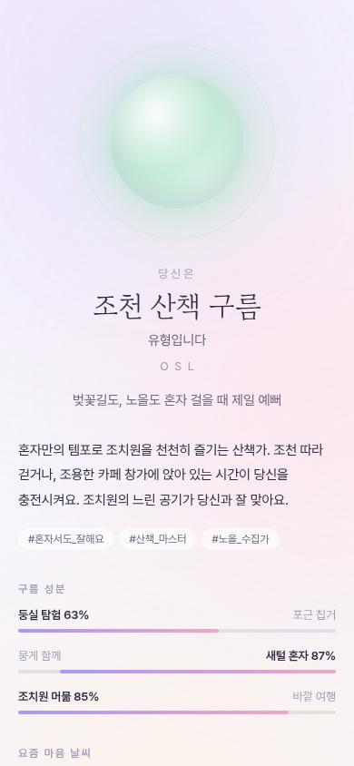

# ☁︎ 나는 어떤 조치원 구름일까?

**조치원 생활환경 및 대학생 소진 경험 조사** (2026 PBL 리빙랩) 온라인 설문 프로토타입.
MBTI 같은 성격유형 테스트 형식으로, 설문을 마치면 8가지 "조치원 구름" 유형, "마음 날씨"(일상 즐거움), "에너지 지도"(일상 의욕)를 보여줍니다.

| 시작 정보 · 동의 | 척도 문항 (점 슬라이더) | 결과 |
|---|---|---|
|  |  |  |

## 디자인

- 명상 앱처럼 차분하고 미니멀한 화면
  - 숨 쉬듯 빛이 퍼지는 **오브(orb)** 하나가 중심 요소
  - 오로라 배경의 색이 챕터마다 천천히 바뀜
- 폰트
  - 본문: **Pretendard** (npm으로 직접 호스팅, 필요한 글자 범위만 받아옴)
  - 제목: **고운바탕**
- 척도 문항(Q9–41, 42-1~3, 44, 45, 47)은 **가로 점 슬라이더** (4점·5점 척도 모두)
  - 탭하거나 드래그해서 고르고, 손을 떼면 잠시 후 다음 문항으로 넘어감
  - 키보드 ←/→, 숫자키도 지원
- 다음 버튼은 화면 아래에 고정되어 휴대폰에서도 항상 보임
- 결과 화면은 아래로 넘기며 섹션이 하나씩 펼쳐지는 구성
- 화면 문구는 최소한으로 줄이고, 문항과 보기는 PDF 원문 그대로 사용

## 구성

- **`/`** 설문. 랜딩 → 설문 안내문(필수 확인) → 이름·전화번호·학교 + 개인정보 동의(필수) → 나이 + 설문지 51개 문항을 한 화면에 하나씩 → 결과
  - 조건부 문항: 8-1(Q8 자주), 8-2(Q8 가끔/거의 없음), 44-1(Q44 1·2점), 46(Q45 1·2점), 47-1(Q47 1·2점)
  - 단일선택·슬라이더는 고르면 바로 다음 문항으로 넘어감, 숫자키/Enter 지원
  - 진행 상황은 브라우저에 자동 저장되어 **이어하기** 가능
  - 전송에 실패하면 브라우저에 보관했다가 다음 방문 때 다시 전송
  - 결과 공유 링크 `/?from=OSL` 로 들어오면 "친구는 ○○ 구름이었어요" 배너 표시
- **`/admin`** 관리자 대시보드 (비밀번호 로그인)
  - 요약: 총 응답, 평균 소요시간, 일상 즐거움 지수, 유형·마음 날씨 분포, 일상 의욕 하위척도 평균, 일별 응답, 생활환경 인식 평균
  - 문항별 결과, 주관식(Q8-2, Q49, Q50), 응답자 목록 (이름·연락처 마스킹, 인터뷰 희망자 필터, 응답 상세)
  - CSV 다운로드 (엑셀 호환 UTF-8 BOM). 이전 설문지(CBI 버전) 응답은 별도 CSV로 받음

## 점수 산출 (`lib/cloudTypes.ts`)

| 축 | 의미 | 사용 문항 |
|---|---|---|
| **O / H** | 둥실 탐험 vs 포근 칩거 | Q6, Q7, Q8, Q43 |
| **T / S** | 뭉게 함께 vs 새털 혼자 | 사회적 동기(Q25·26·27·31·37·40) + Q6, Q43, Q48 |
| **L / E** | 조치원 머묾 vs 바깥 여행 | Q9–13 평균, Q5, Q6, Q43 |

- **일상 즐거움 지수 / 마음 날씨** (4. 일반 피로 측정, Q14–23)
  - 4점 척도, 부정 문항 Q15·18·19·20·22 역채점, 평균을 0~100으로 환산 (높을수록 즐거움)
  - 맑음 ≥75 · 구름 조금 ≥50 · 흐림 ≥25 · 소나기 <25
- **에너지 지도** (5. 일상 의욕 및 동기, Q24–41 = Apathy-Motivation Index 18문항과 같은 순서)
  - 행동 에너지(BA): Q28·32·33·34·35·38 / 사람 에너지(SM): Q25·26·27·31·37·40 / 마음 감도(ES): Q24·29·30·36·39·41
  - 5점 응답 평균을 0~100으로 환산 (높을수록 의욕적, 원 척도의 무감동 점수 = 100 − 값)
- 결과 화면의 점수는 재미용 지표. 연구 분석은 CSV 원자료와 원 척도 채점 방식을 기준으로 할 것

## 개인정보

- 시작 화면에서 **이름, 전화번호, 학교(고려대학교 / 홍익대학교)** 를 받음
  - 셋 다 필수, 전화번호 형식 검증은 하지 않음 (완료율 우선)
- 개인정보 수집·이용 동의는 **필수**. 동의해야 문항으로 넘어감
  - 서버도 동의가 없는 응답은 저장하지 않음 (`app/api/responses/route.ts`)
- 나이는 설문지 외에 추가한 문항으로, '1. 기본 정보' 맨 앞에 숫자로 입력
- 안내문대로 성명·연락처는 응답 표와 **분리된 표(`survey_contacts`)** 에 응답 ID로만 연결해 보관
  - 관리자 화면과 CSV에서는 둘을 합쳐서 보여줌
- 응답마다 `survey_version`(현재 2)을 저장. 이전 설문지 응답(버전 1)은 대시보드 집계에서 제외

## 로컬 실행

```bash
npm install
npm run dev          # http://localhost:3000 , 관리자: /admin (기본 비밀번호 chowon2026)
```

- Supabase 환경변수가 없으면 응답은 `.data/responses.json` 에 저장 (프로토타입 모드)
- 관리자 화면의 **데모 응답 40개 추가** 버튼으로 대시보드를 미리 볼 수 있음

## 배포 (Vercel + Supabase)

1. Vercel에 이 저장소를 Import
2. Vercel 프로젝트 → **Storage / Integrations** 에서 Supabase를 연결
   - 연동이 `SUPABASE_URL`, `SUPABASE_SERVICE_ROLE_KEY`, `POSTGRES_URL` 등을 자동으로 넣어줌
3. 환경변수에 `ADMIN_PASSWORD` 추가 (**반드시 변경**) 후 다시 배포
4. `/admin` 로그인 → **테이블 만들기** 버튼
   - `POSTGRES_URL` 로 `supabase/schema.sql` 을 실행해 `survey_responses` 테이블을 만듦
   - 버튼이 안 보이거나 실패하면 `supabase/schema.sql` 을 Supabase SQL Editor에서 직접 실행
5. 배지가 "Supabase 연결됨"으로 바뀌면 준비 완료

> ⚠️ Vercel은 파일 시스템이 영구 저장되지 않으므로 Supabase 없이 배포하면 응답이 사라집니다.

## 파일 구조

```
app/                  페이지 & API 라우트 (Next.js App Router)
components/Survey.tsx 설문 흐름 전체
components/ResultView.tsx 결과 화면
components/AdminDashboard.tsx 관리자 대시보드
components/Art.tsx     오브, 점 슬라이더, 날씨 아이콘
components/Sky.tsx     오로라 배경
lib/questions.ts      문항 정의 (문항 수정은 여기서)
lib/cloudTypes.ts     8가지 유형 설명·채점 로직
lib/store.ts          저장소 (Supabase ↔ 로컬 파일)
supabase/schema.sql   DB 스키마
```
